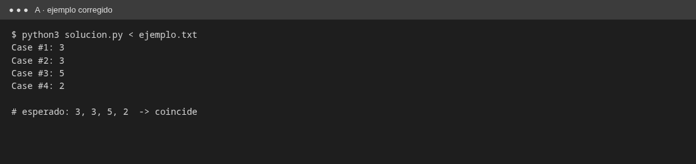
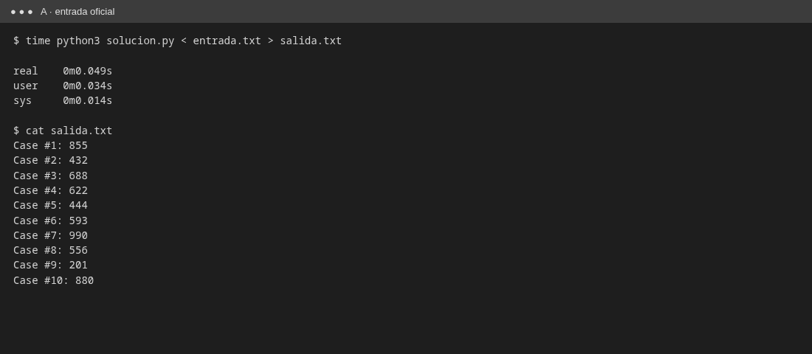

# SOGR_TESTS_GA
Los test de google y anthropic

## Prueba Google · Hackatón individual — Solución

- **Participante:** Juan Pablo Vega Villamil
- **Código de la prueba:** GOOGLE-04
- **Lenguaje:** Python 3

Cada ejercicio tiene su carpeta con la solución (`solucion.py`), el ejemplo del enunciado (`ejemplo.txt`), mi entrada oficial (`entrada.txt`), la salida que entregué (`salida.txt`) y las capturas en `evidencias/`.

Para correr cualquiera:

```bash
python3 solucion.py < entrada.txt
```

---

### A · d1000000 (Code Jam 2022 · Ordenamiento y voraz)

📁 [A_d1000000/](A_d1000000/)

**La idea.** Si ordeno los dados de menor a mayor número de caras, puedo recorrerlos e ir armando la escalera: si el dado actual tiene más caras que el largo que llevo, sirve para poner el siguiente escalón y sumo uno; si no, lo descarto porque no alcanza. Usar primero los dados pequeños es lo que conviene, porque los grandes siempre van a servir más adelante. Queda en O(N log N) por el ordenamiento, que con N = 1.000 es nada.

Esta es mi entrada oficial generada con mi nombre y el código GOOGLE-04:


**Lo que salió mal al principio.** La primera versión la hice a la carrera y tenía dos errores:

1. Asumí que cada caso venía en **una sola línea** (N y los valores juntos), pero en realidad N va en una línea y los S<sub>i</sub> en la siguiente. Entonces el programa estaba leyendo líneas que no eran.
2. Ordené los valores **como texto** (se me olvidó pasarlos a `int` antes del `sorted`), así que `"10"` quedaba antes que `"9"` y el voraz se dañaba.

El ejemplo daba `0, 2, 0, 2` cuando debía dar `3, 3, 5, 2`:


**Cómo lo corregí.** Cambié la lectura para tomar toda la entrada como una lista de números (tokens) y no depender de cómo vengan partidas las líneas, y ordené ya convertidos a entero. Con eso el ejemplo cuadró:



**Entrada oficial.** Corre en menos de 0,1 s. Esta es la salida que le entregué al jurado:



Resultado: **10/10 casos correctos** ✅
