# SOGR_TESTS_GA
Los test de google y anthropic

## Prueba Google - Hackatón individual

Juan Pablo Vega Villamil · código de la prueba GOOGLE-04 · todo en Python 3

Todo está en la carpeta [Google/](Google/). En cada ejercicio está la solución, el ejemplo del enunciado, mi entrada oficial, la salida que entregué y las capturas. Se corre con:

```bash
python3 solucion.py < entrada.txt
```

---

### A - d1000000

Carpeta: [Google/A_d1000000/](Google/A_d1000000/)

Este era el más tranquilo. Se ordenan los dados de menor a mayor y se va armando la escalera: si el dado tiene más caras que el largo que llevo, sirve para el siguiente escalón, si no, se bota. Gastar primero los dados pequeños es lo que conviene porque los grandes igual sirven después.

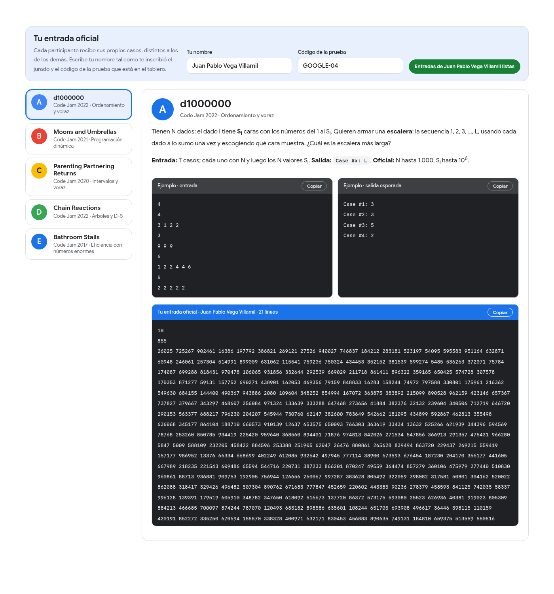

Eso sí, la primera versión la hice muy a la carrera: leía cada caso como si N y los valores vinieran en la misma línea y además ordenaba los números como texto. El ejemplo daba cualquier cosa:

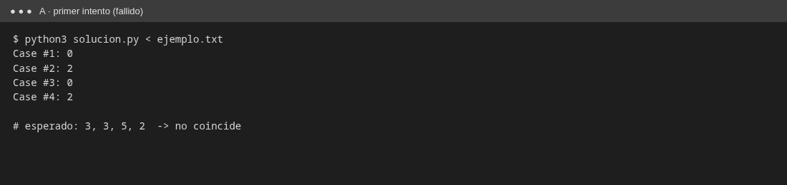

Lo cambié para leer toda la entrada como una lista de números, convertidos a int antes de ordenar, y ya cuadró.


Con la entrada oficial corre en nada:


10/10 casos correctos.

---

### B - Moons and Umbrellas

Carpeta: [Google/B_moons_and_umbrellas/](Google/B_moons_and_umbrellas/)


Aquí me confié. Rellené cada `?` con la letra de antes para no crear parejas CJ o JC nuevas, el ejemplo pasó completo y casi lo entrego así :v. Ya con la entrada oficial la mitad de los casos salían mal, todos con X o Y negativos. Tenía sentido: si una pareja da plata en vez de costar, toca meterla a propósito, y copiando la letra anterior eso nunca pasa.


Terminó siendo programación dinámica con dos estados: el costo mínimo hasta cada posición si la última letra es C o si es J. Pasar de J a C suma Y y de C a J suma X, y al final se toma el menor. Es lineal, así que las cadenas de 1000 caracteres no son problema.


10/10 casos correctos.

---

### C - Parenting Partnering Returns

Carpeta: [Google/C_parenting_partnering/](Google/C_parenting_partnering/)


Se ordenan las actividades por hora de inicio y para cada una se mira quién está libre: si Cameron ya terminó lo suyo se la doy a él, si no a Jamie, y si ninguno de los dos puede es IMPOSSIBLE. Como la respuesta va en el orden de la entrada, guardo el índice original de cada actividad antes de ordenar para poner la letra donde toca.

El ejemplo me dio `JCCJJ` en el caso 3 en vez de `CJJCC`. Al principio me asusté, pero es la misma repartición con los papás cambiados, y el enunciado dice que cualquier asignación válida sirve.

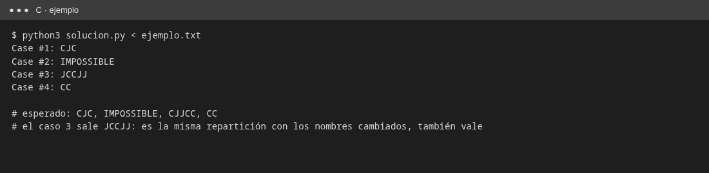

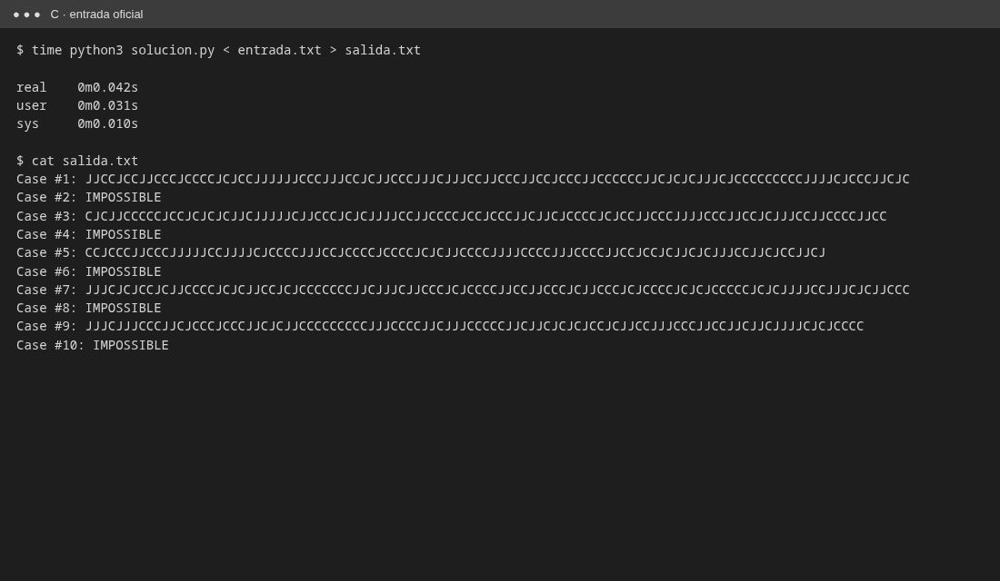

10/10 casos correctos (la mitad son IMPOSSIBLE, que el verificador también confirmó).

---

### D - Chain Reactions

Carpeta: [Google/D_chain_reactions/](Google/D_chain_reactions/)

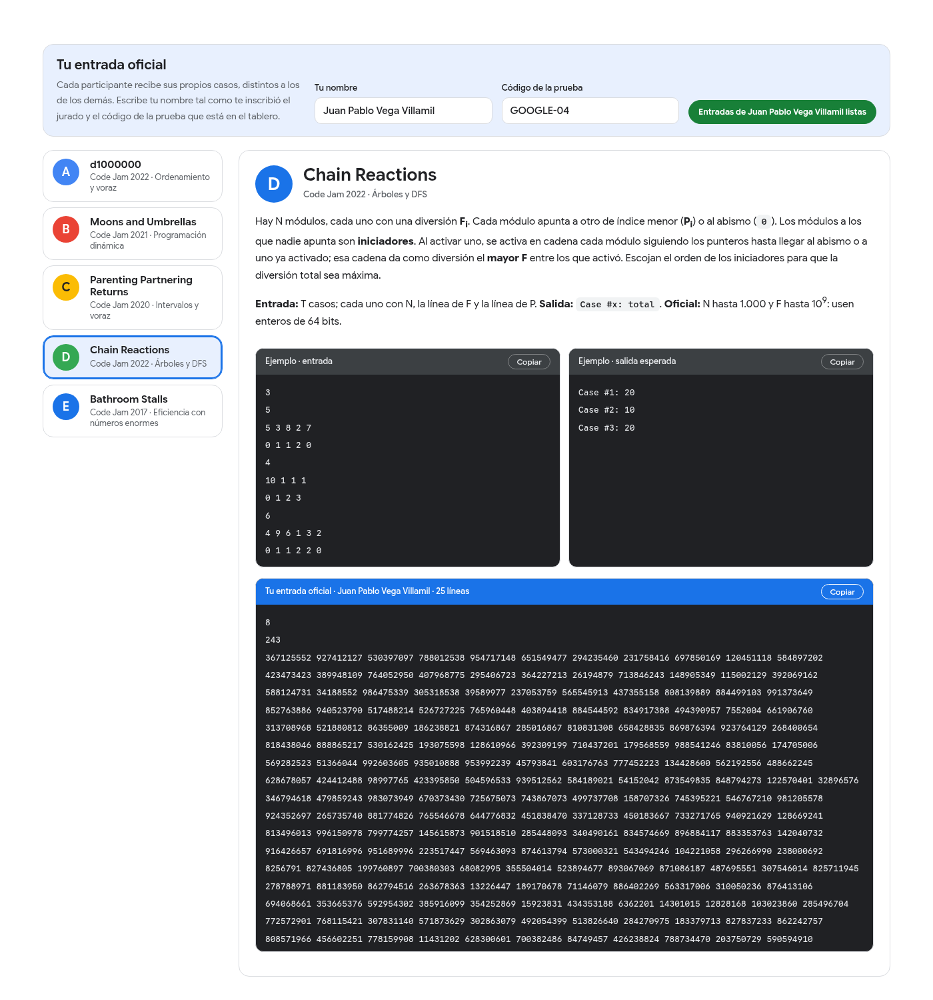

Los módulos forman un árbol con raíz en el abismo y los iniciadores son las hojas. El truco está en cada nodo con varios hijos: solo una de las cadenas que llegan puede seguir subiendo, y las otras se quedan cobrando su máximo ahí. Lo que conviene es dejar seguir la de menor valor, porque al subir lo más probable es que se la coma un F más grande de arriba, y las grandes se cobran de una. Entonces cada nodo pasa hacia arriba `max(F, menor de sus hijos)` y al total se le suma el resto.

Me salvó que P siempre apunta a un índice menor: recorriendo de N hasta 1 los hijos siempre quedan listos antes que el papá, así que no hizo falta DFS recursivo ni pelear con el límite de recursión de Python. Los totales llegan a ~10^12, pero en Python los enteros no se desbordan.

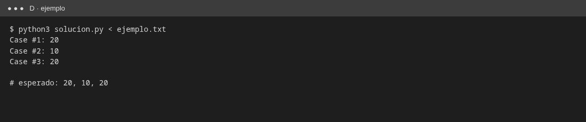

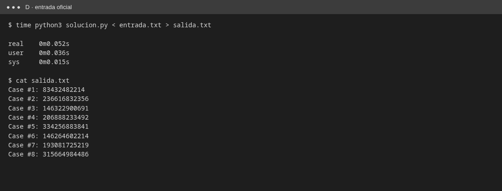

8/8 casos correctos.

---
---

## Prueba Anthropic - La API de Claude

Juan Pablo Vega Villamil · código de la prueba ANTHROPIC-04 · también en Python 3

Todo está en la carpeta [Anthropic/](Anthropic/), con la misma estructura de antes: solución, ejemplo, entrada oficial, salida y capturas. Solo usé la librería `json` de Python.

---

### A - Respuesta en streaming

Carpeta: [Anthropic/A_streaming/](Anthropic/A_streaming/)

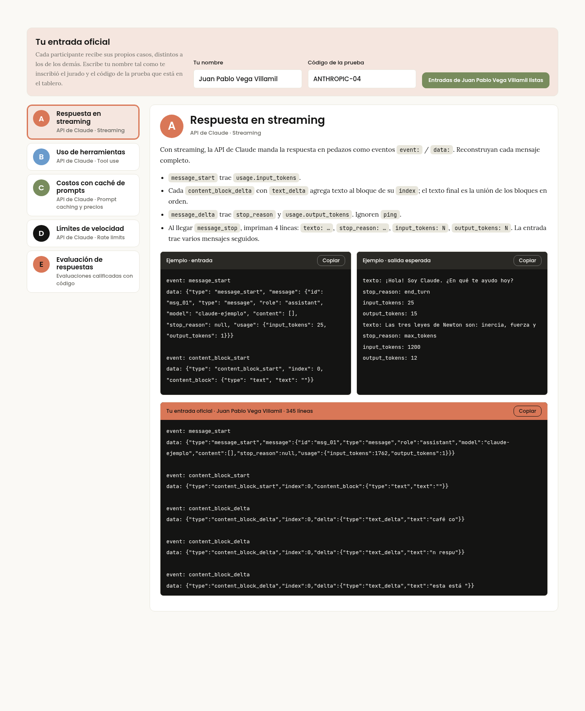

Las líneas `event:` se pueden ignorar porque el tipo ya viene dentro del JSON de `data:`. Entonces leo solo esas, las parseo y según el `type` voy llenando: `message_start` reinicia todo y guarda los tokens de entrada, cada `text_delta` se pega al bloque de su `index`, `message_delta` trae el `stop_reason` y los tokens de salida, y en `message_stop` imprimo las 4 líneas. Los `ping` y los start/stop de bloque no aportan nada.

Los bloques los guardo en un diccionario por índice y los uno ordenados al final, por si algún día llegan intercalados. Puse `stdout` en UTF-8 para que no se dañen las tildes ni los signos de "¡" y "¿".

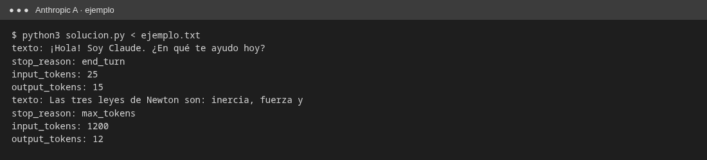

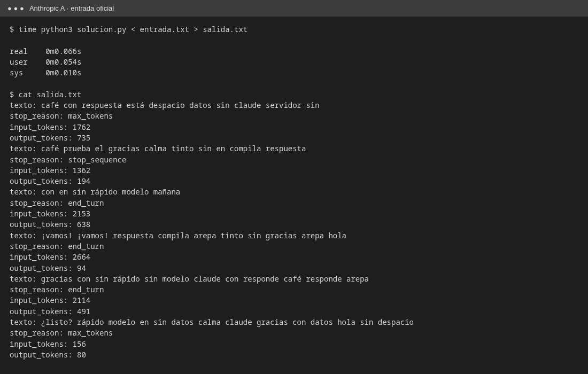

Las 24 líneas (6 mensajes) correctas.

---

### B - Uso de herramientas

Carpeta: [Anthropic/B_herramientas/](Anthropic/B_herramientas/)

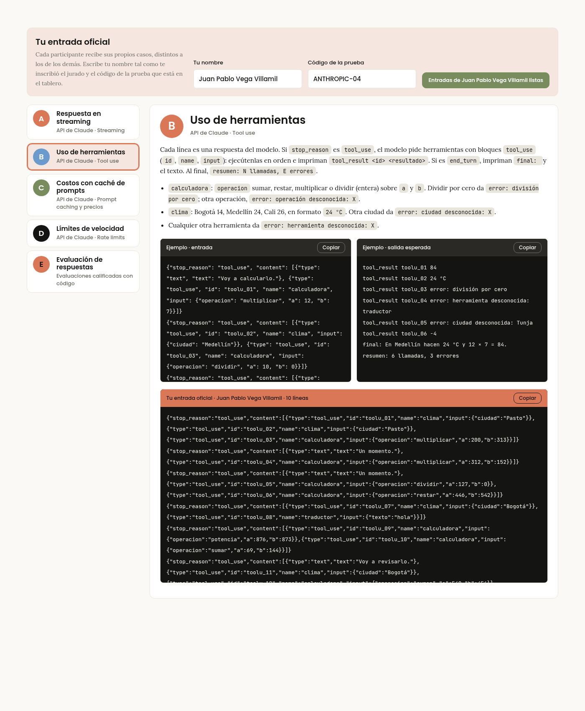

Cada línea es un JSON con la respuesta del modelo. Si el `stop_reason` es `tool_use` recorro el `content` y ejecuto los bloques `tool_use` en orden, y si es `end_turn` imprimo el texto final. Las herramientas quedaron como funciones en un diccionario por nombre, así que si llega una que no está ahí (traductor, buscar_web...) sale directo el error de herramienta desconocida. Para contar errores basta con ver si el resultado empieza por `error:`.

Lo único con maña fue la división entera: el `//` de Python redondea hacia abajo, entonces `-7 // 2` da `-4` y no `-3`. En mi entrada no hay negativos dividiendo, pero lo dejé truncando hacia cero por si acaso.

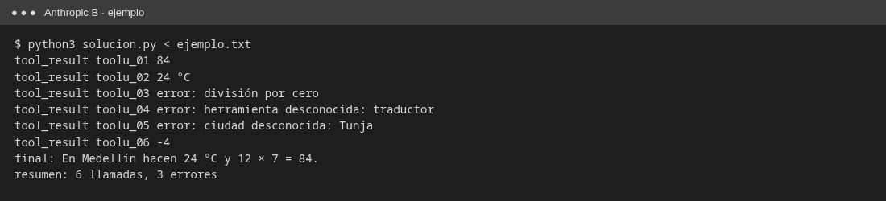

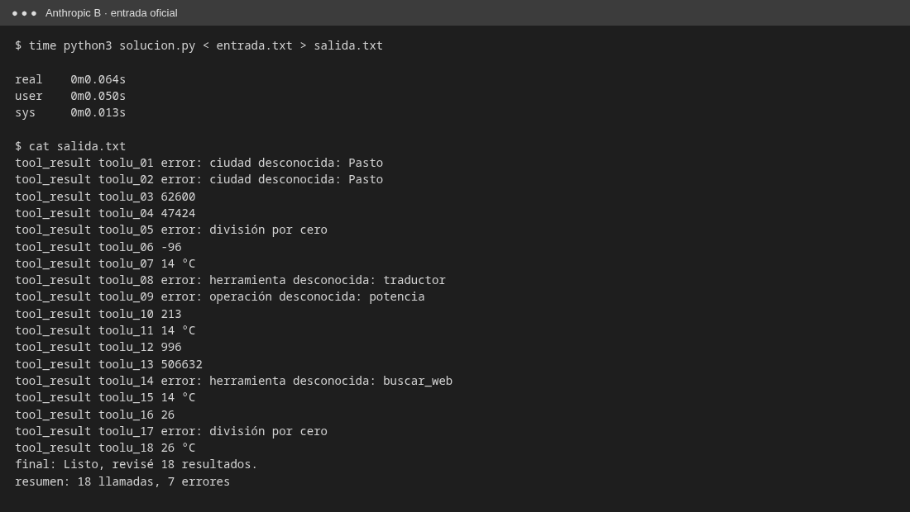

20/20 líneas correctas (18 llamadas, 7 errores).

---

### C - Costos con caché de prompts

Carpeta: [Anthropic/C_costos_cache/](Anthropic/C_costos_cache/)

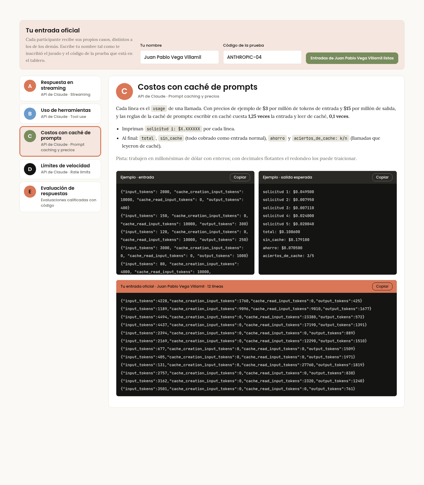

Primero lo hice con flotantes y `:.6f`, y la verdad pasó todo. Igual lo cambié a enteros, porque la misma página avisa que el redondeo puede fallar y no quería que dependiera de la suerte con otra entrada.

La cuenta es en millonésimas de dólar: $3 por millón son 3 micro-dólares por token y $15 son 15. Para no meter el 1,25 ni el 0,1 multipliqué todo por 100 (entrada 300, escribir en caché 375, leer de caché 30, salida 1500) y al final divido entre 100. En mi entrada esa división siempre da exacta, porque los tokens de escritura vienen en múltiplos de 4 y los de lectura en múltiplos de 10. Para imprimir, la parte entera son los dólares y el resto va con 6 dígitos rellenando con ceros.

`sin_cache` es lo mismo pero cobrando todos los tokens de entrada como normales, y el ahorro es la resta.

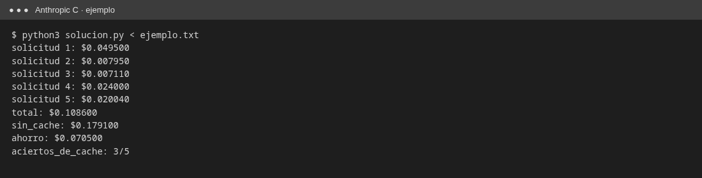

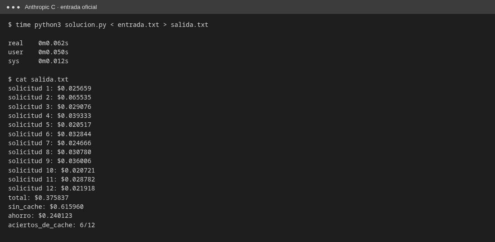

16/16 líneas correctas.
