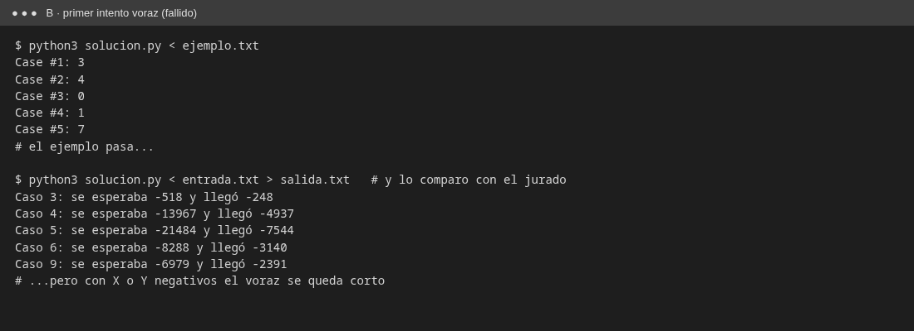
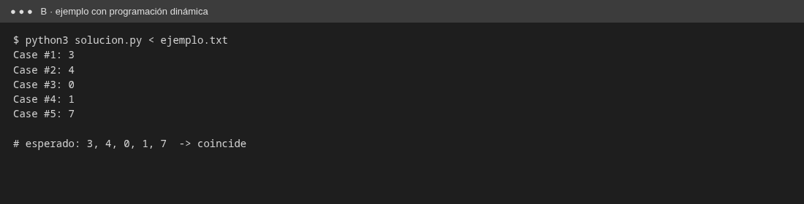
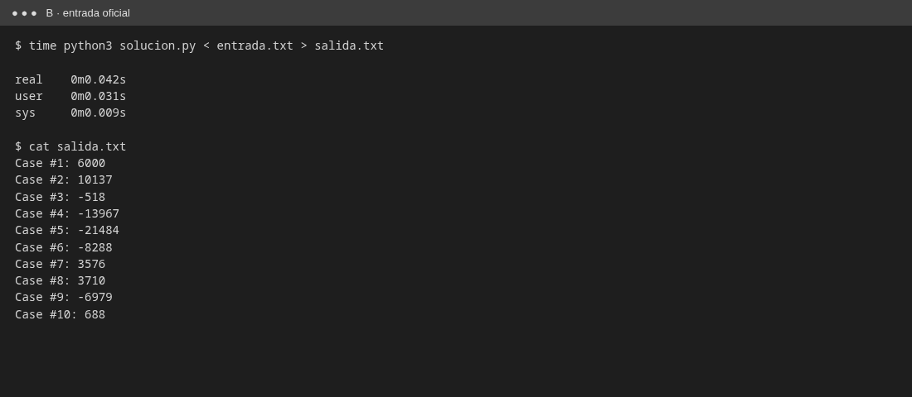

# SOGR_TESTS_GA
Los test de google y anthropic

## Prueba Google - Hackatón individual

Juan Pablo Vega Villamil · código de la prueba GOOGLE-04 · todo en Python 3

En cada carpeta está la solución, el ejemplo del enunciado, mi entrada oficial, la salida que entregué y las capturas. Se corre con:

```bash
python3 solucion.py < entrada.txt
```

---

### A - d1000000

Carpeta: [A_d1000000/](A_d1000000/)

Este era el más tranquilo. Se ordenan los dados de menor a mayor y se va armando la escalera: si el dado tiene más caras que el largo que llevo, sirve para el siguiente escalón, si no, se bota. Gastar primero los dados pequeños es lo que conviene porque los grandes igual sirven después.


Eso sí, la primera versión la hice muy a la carrera: leía cada caso como si N y los valores vinieran en la misma línea y además ordenaba los números como texto. El ejemplo daba cualquier cosa:


Lo cambié para leer toda la entrada como una lista de números, convertidos a int antes de ordenar, y ya cuadró.


Con la entrada oficial corre en nada:


10/10 casos correctos.

---

### B - Moons and Umbrellas

Carpeta: [B_moons_and_umbrellas/](B_moons_and_umbrellas/)


Aquí me confié. Rellené cada `?` con la letra de antes para no crear parejas CJ o JC nuevas, el ejemplo pasó completo y casi lo entrego así :v. Ya con la entrada oficial la mitad de los casos salían mal, todos con X o Y negativos. Tenía sentido: si una pareja da plata en vez de costar, toca meterla a propósito, y copiando la letra anterior eso nunca pasa.



Terminó siendo programación dinámica con dos estados: el costo mínimo hasta cada posición si la última letra es C o si es J. Pasar de J a C suma Y y de C a J suma X, y al final se toma el menor. Es lineal, así que las cadenas de 1000 caracteres no son problema.





10/10 casos correctos.
